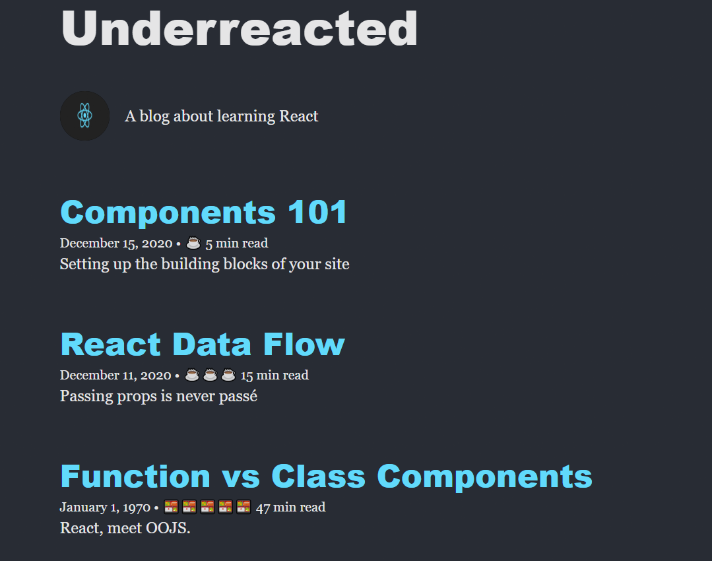

# Underreacted: Blog Site

A static personal blog site built with **React** and **Vite**. It practices building components, writing JSX, and passing data down as **props**.

## Features

- Blog data lives in one place (`src/data/blog.js`) and is passed down from `App` as props
- Four components: `Header`, `About`, `ArticleList`, `Article`
- Accessible logo image (`alt="blog logo"`) with a default image
- Default date for posts with no date
- Bonus: "minutes to read" indicator (☕️ per 5 min under 30 min, 🍱 per 10 min from 30 min up)
- Tests with Vitest and React Testing Library

## Component tree

```
App
├── Header
├── About
└── ArticleList
    └── Article
```

| Component   | Props passed in                  | Connected to                  |
| ----------- | -------------------------------- | ----------------------------- |
| App         | none (imports `blog.js`)         | Parent of Header, About, ArticleList |
| Header      | `name`                           | Child of App                  |
| About       | `image`, `about`                 | Child of App                  |
| ArticleList | `posts`                          | Child of App, parent of Article |
| Article     | `title`, `date`, `preview`, `minutes` | Child of ArticleList     |

## Run the project

You need [Node.js](https://nodejs.org/) (v18 or newer) and npm.

```bash
# 1. Clone the repository
git clone https://github.com/kuriajosh777/Lab-Blog-Site.git
cd Lab-Blog-Site
# 2. Install dependencies
npm install

# 3. Start the dev server
npm run dev
```

Open the local URL shown in the terminal (usually http://localhost:5173).

## Run the tests

```bash
npm test
```

(Press `q` to quit watch mode, or run `npx vitest run` for a single run.)

## Screenshot



## Project structure

```
src/
├── assets/logo.js
├── components/
│   ├── App.jsx
│   ├── Header.jsx
│   ├── About.jsx
│   ├── ArticleList.jsx
│   └── Article.jsx
├── data/blog.js
├── __tests__/        # Header, About, Article, ArticleList, App tests
├── index.css
└── main.jsx
```
